# NEXUS BANK — Phase 8

NEXUS BANK is a local sandbox with real customer sessions, SQLite records,
ledger transactions and browser HTTP workflows. All funds are simulated. It
adds customer banking to the existing VEILMINT application; the original AST
analyzer, policy compiler/store, golden demo, runtime and canary are retained.
Phase 7 presentation work remains postponed.

## Data flow and access boundary

```mermaid
flowchart LR
  Customer[Customer browser / Laptop 2] -->|same-origin HTTP| Public[Customer Nginx :8081]
  Public -->|only /api/bank/*; operator header stripped| API[FastAPI banking routes]
  API --> Auth[HttpOnly session + ownership checks]
  Auth --> Ledger[Bank service / SQLite atomic ledger]
  Ledger --> DTO[Intentional account DTO]
  DTO --> Engine[Existing VEILMINT APIEnforcer]
  Engine --> Customer
  API --> Metadata[Minimal operational metadata + correlation ID]
  Metadata --> Logs[Existing StructuredLogPipeline]
  Logs --> Sink[Sanitized SQLite log sink]
  Sink --> Events[Safe traffic events / no raw response values]
  Events -->|3-second polling| Console[Host-only VEILMINT console :8080]
  Console -->|private proxy credential| Review[Endpoint-specific review and policy store]
  Review --> Engine
```



The backend and SQLite have no published ports. The operator proxy is bound to
127.0.0.1:8080. Its generated private credential is injected server-side by
Nginx, never delivered to JavaScript. Customer cookies grant no operator access.
The customer proxy serves `/bank/` and assets, forwards only `/api/bank/*`,
strips forged operator headers and blocks policy, traffic, docs and environment
paths. Native development without a proxy credential permits operator requests
only from the loopback host (and TestClient); it is not a LAN operator mode.

## Start, migrate and stop

From the repository root, after installing Docker Desktop:

```powershell
python scripts/configure_bank.py
docker compose build
docker compose up -d --wait --wait-timeout 90
docker compose ps
```

Open the customer app at **http://localhost:8081/bank/**. Open the local operator
console at **http://localhost:8080**. Registration and login use fictional
usernames/display names and a unique demo password of at least 12 characters.
No default customer or password is seeded. Registration starts with zero funds
and an empty ledger. The schema is initialized non-destructively on readiness
or first bank use. `nexus_schema` tracks the additive bank schema (currently version 3) independently of
VEILMINT's existing schema marker. No database recreation/reset occurs.

To stop while preserving customer data and all existing VEILMINT history:

```powershell
docker compose down
```

The existing `demo-data` volume holds the bank tables, original golden policies,
protected logs and traffic events. Separate destination policy database files
live beside the main database in the same volume. Do not use `down -v`.

Native development remains available:

```powershell
python -m venv .venv
.\.venv\Scripts\python.exe -m pip install -e ".[dev]"
.\.venv\Scripts\python.exe -m uvicorn veilmint.server:create_app --factory --host 127.0.0.1 --port 8000 --no-access-log
```

In another terminal run `cd frontend`, `npm ci`, `npm run dev`; use
http://localhost:5173/bank/ for customers and `/` for the operator. Native Python
uses process environment, not `.env`. Compose reads `.env` automatically.

## Explicit sandbox funding

Register two fictional customers in separate browser sessions (or log out and
register the second). Each overview displays its shareable sandbox 12-digit account ID
and only a masked internal account reference. The numeric ID is sufficient to add a
beneficiary; a full account number is never returned to customers.

Funding is an operator CLI action, not a public or customer HTTP endpoint:

```powershell
docker compose exec backend python -m veilmint bank fund --account ACCOUNT_ID --amount-minor 100000 --reference DEMO_OPENING_001 --sandbox-funds
```

That adds INR 1,000.00 of **simulated** funds with an explicit funding ledger
entry and sanitized request/result audit events. Repeating the same account,
reference and amount adds nothing twice; using a conflicting amount is rejected.
There is no silent funding or invented transaction history. For native runs use
`python -m veilmint bank fund` with the same arguments and the appropriate
`VEILMINT_DB` process environment.

Add the second customer's account ID as a beneficiary, select it in Transfer, enter
an amount, review and confirm. The UI converts decimal input to integer paise
using string/BigInt arithmetic. Server/Pydantic rejects floats, zero, negative
amounts, excessive precision and unsupported currencies. Only INR is supported;
maximum transfer is 100,000,000 paise. No overdraft, self-transfer or transfer
between the same owner's accounts is allowed. Accounts must be active.

The bank computes balance from immutable ledger entries. A `BEGIN IMMEDIATE`
transaction checks ownership, destination/currency, funds and idempotency, then
writes the transfer and both ledger entries atomically. There is no cached
balance to drift. Repeated requests with the same customer/key return the same
receipt; changed details with a reused key are rejected. The UI disables double
submission and retains the reviewed key for retry after network/server failure.
A full page reload clears that in-memory review; inspect history before creating
a new transfer after an ambiguous outcome. No reversal feature is implemented.

## Customer API and sessions

| Route | Access / effect |
|---|---|
| POST `/api/bank/auth/register` | Creates customer + zero-funded account |
| POST `/api/bank/auth/login` | Argon2id verification; server-managed session |
| POST `/api/bank/auth/logout` | Revokes session; clears cookie |
| GET `/api/bank/customers/me` | Own display name and customer ID |
| GET `/api/bank/accounts` | Own account summaries and masked references |
| GET `/api/bank/accounts/{account_id}` | Own details; VEILMINT account policy |
| GET `/api/bank/accounts/{account_id}/transactions` | Own ledger; limit 1–100, bounded pagination |
| GET/POST `/api/bank/beneficiaries` | Own saved eligible internal recipients |
| POST `/api/bank/transfers` | Atomic idempotent simulated transfer |
| GET `/api/bank/transfers/{transfer_id}` | Sender-owned transfer receipt |

Passwords use Argon2id (19 MiB, two iterations, one lane); the database stores
hashes only. Session secrets are generated cryptographically, stored only as
SHA-256 hashes server-side and sent as HttpOnly, SameSite=Strict cookies scoped
to `/api/bank`, expiring in eight hours. No credential/token is placed in browser
storage or logs. State-changing requests require a custom `X-Nexus-Request: 1`
header and reject mismatched Origin headers. No permissive CORS is enabled.
Login attempts are limited to ten per normalized username per minute; this is a
small local limiter, not production abuse protection. Existing username
registration is a generic rejection; login errors do not confirm existence.

## Endpoint-specific VEILMINT protection

The destination is **`nexus_bank.account_summary.v1`**, not a customer URL.
`bank/protection.py` contains a versioned, explicit, reviewable account consumer
contract and response schema. It validates a synthetic contract sample and the
actual service DTO. This is **not** TypeScript AST analysis. The documented
contract maps to the real fields read by `frontend/src/bank/BankApp.tsx`; changes
to that consumer must be reflected in this contract by its maintainer.

The eight required fields are USED: account ID, display name, account type,
currency, status, masked reference, integer balance and recent transactions.
`legacy_display_label` is a deprecated optional compatibility label excluded by
the explicit consumer contract. It is only a review candidate, not automatically
removed. No raw account number, internal risk flag or password model field is
included in the DTO, even under missing-policy fallback.

In the operator console open **Policy review**, select **NEXUS BANK · account summary**, and prepare a revision,
inspect evidence/actions, select the compatibility-label candidate and supply
a reviewer label. Preview and confirm explicitly. Approval is bound to the new
bank revision/digests; the old 10-field golden approval is never reused. Only
that reviewed candidate may disappear (9→8 fields); USED fields stay unchanged.
The original golden fixture remains separately available (10→6).

`NEXUS_MODE` defaults to ENFORCE, but no removal happens until valid approval.
OBSERVE/WARN preserve the DTO. Missing, corrupt, destination-mismatched or stale
policies retain it with a safe decision warning. A new field is retained and
reported as unmapped. Schema/contract changes produce a new digest and require
new review. Only account details use this policy; beneficiary and transfer DTOs
do not inherit it. Operator routes are `/api/bank-policy`, its `/revisions` and
`/review` children, and `/api/traffic`. Existing policy APIs remain intact.

## Logs, real traffic and investigation

Each actual bank request receives a fresh server-generated `X-Request-ID`.
The customer footer shows its latest ID. The bank operation, account protection
trace, sanitized log and persisted traffic event share it. Transfer initiation
and result are separately visible under that same ID. Funding events are
explicit CLI events, never presented as browser activity.

The existing StructuredLogPipeline processes minimal server-owned metadata
before LogSink insertion. Profile/account references are MASKed; explicit
financial/password/token/full-account-number keys are DROP. Safe operational
fields use ALLOW. This log-only configuration approves no candidate removals.
There are no copied request/response bodies, passwords or full financial records
in ordinary events. Unknown log fields retain the existing conservative masking
behavior. Sanitizer/storage failure returns a safe 503; no raw fallback occurs.
Business state may already be committed: retry a transfer with its same key.

**Live bank traffic** polls every three seconds. It displays up to 100 recent
actual records, with 1,000 retained in `nexus_security_events`. There is a true
empty state and an explicit disconnected state; no invented counts/latency.
Latency is measured with a monotonic timer through response generation, before
final log persistence. Request Detail exposes endpoint template, correlation
ID, policy revision, kept/removed field paths, warnings, safe log action paths
and sanitized record ID. No raw preview is implemented or enabled. Underlying
bank records (including hashes and the private internal account reference) are
bank-domain data, not security-event copies; SQLite is not encrypted at rest.

## Two laptops on an isolated trusted LAN

Enable only the customer entry point explicitly:

```powershell
python scripts/configure_bank.py --lan
docker compose up -d --wait --wait-timeout 90
```

The command sets `LAN_DEMO=true` and the effective binding switch
`NEXUS_BIND=0.0.0.0`. The operator console stays loopback-only. Return to host-only
mode with `python scripts/configure_bank.py` and run Compose up again.
Find Laptop 1's Wi-Fi/Ethernet IPv4 using `ipconfig` on Windows or `ip -4 addr`
on Linux. On Laptop 2 open **`http://LAPTOP_1_LAN_IP:8081/bank/`**. The frontend
uses relative URLs, so requests go to Laptop 1, never Laptop 2's localhost.
If blocked, check that both devices share the trusted network, client isolation
is off and the host firewall permits TCP 8081 for that private network. No
firewall/security settings were modified automatically.

Register/login in Laptop 2's browser, add an eligible beneficiary, transfer
explicitly funded sandbox money and inspect history. On Laptop 1 find the shown
request ID in Live bank traffic and inspect its sanitized log receipt.
The DB and backend stay private; customers cannot reach policy/traffic routes
through port 8081 even with a forged operator header.

**Plain HTTP is only for a controlled, isolated LAN demonstration with fictional
credentials/data.** It does not protect sessions from network interception. Use
HTTPS and `NEXUS_SECURE_COOKIE=true` before considering any broader environment.
No public deployment is supported. Physical two-device testing is **NOT VERIFIED**
in this environment; localhost proxy checks are not a substitute.

## Checks

```powershell
.\.venv\Scripts\python.exe -m pytest -q
.\.venv\Scripts\python.exe -m pip check
cd frontend
npm run typecheck
npm test
npm run build
npm audit
```

For the opt-in React form / real HTTP integration test, start a separate native
backend using a fresh `VEILMINT_DB` path on port 8128, then in another terminal:

```powershell
$env:NEXUS_E2E_URL='http://127.0.0.1:8128'
$env:NEXUS_E2E_DB='ABSOLUTE_PATH_TO_THE_SAME_TEMPORARY_DATABASE'
$env:NEXUS_TEST_PYTHON='ABSOLUTE_PATH_TO_VENV_PYTHON'
cd frontend
npm test -- src/bank/BankApp.e2e.test.tsx
```

Alternatively run the complete isolated setup and teardown automatically:

```powershell
.\.venv\Scripts\python.exe scripts/verify_bank_ui.py
```

To run the local Docker HTTP/restart acceptance flow explicitly:

```powershell
.\.venv\Scripts\python.exe scripts/verify_bank_docker.py
```

That command registers clearly fictional verification customers through the
real HTTP API, funds one explicitly, creates real transfer activity and restarts
the local stack to check persistence. It preserves those verification records,
does not print credentials and leaves bank candidate approval pending for an
operator. Summary evidence goes to ignored `data/phase8-docker-verification.json`.

This mounts the real React forms in jsdom, sends real HTTP requests and manages
a test-only cookie jar. It is not a physical browser, visual QA or two-device
test. It registers two fictional customers, explicitly funds one using the CLI,
saves a beneficiary, transfers funds and checks both customers' histories. It
is skipped in the regular frontend command unless those variables are supplied.

Container backend tests can be run with a read-only bind of the local `tests`
directory to `/app/tests` and `docker compose run --rm --no-deps --volume
LOCAL_TESTS_PATH:/app/tests:ro backend python -m pytest -q -p no:cacheprovider
/app/tests`. The original synthetic canary remains available via
`docker compose exec backend python -m veilmint demo check --db /data/synthetic-demo.sqlite3`.
That canary proves the original defined paths only; it is not a claim of bank
security. Bank integration tests independently check actual bank responses,
approval scope, stale policies, logs and correlation.

## Limits

Single-process local SQLite sandbox; no real rails/money, MFA, password recovery,
production authentication/RBAC, compliance claims, exhaustive fraud detection or
external integrations. Operator access trusts the local host and generated proxy
credential. There is no cross-device acceptance claim, production security claim,
raw customer response inspector or final presentation package. Historical source
layout tests are preserved. Prior tests/builds were rerun before implementation.

## Workbench navigation update

Bank endpoint policy and the original example review now share **Policy review**
with an explicit destination selector. Field evidence uses that selection.
Original example API/log/canary tools are under **Demo examples**. The operator's
**Accounts Explorer** and **Protection inspector** expose masked read-only bank
records and actual persisted customer-request evidence. See
[operator inspection](operator-inspection.md) for optional fictional profile
setup and the distinction between contract exclusion, approved API removal,
header-value exclusion and log MASK/DROP. Bank schema version 3 is additive;
existing account DTOs and policy approval digests are preserved.
